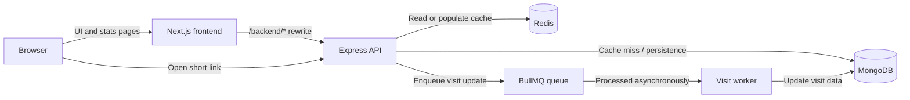
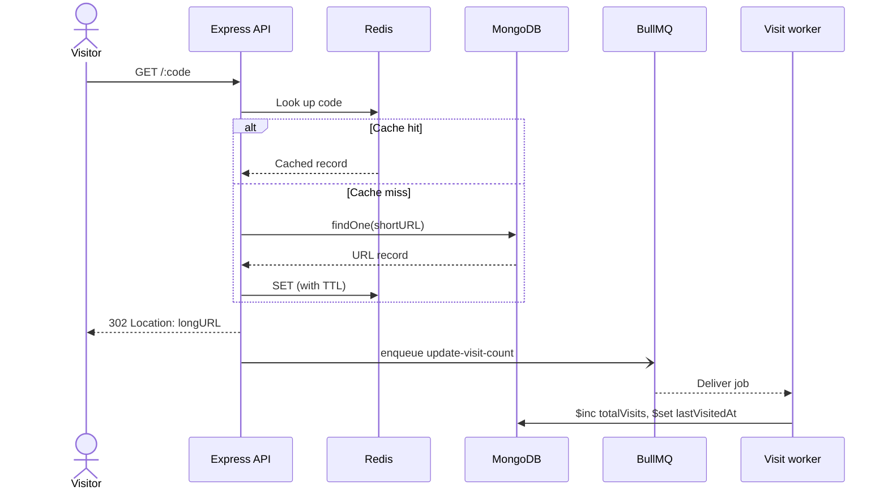

<div align="center">

# 🔗 URL Shortener

**Long URLs in. Short links out. Fast redirects, async analytics.**

A full-stack URL shortener — **Next.js** frontend, **Express** API, **MongoDB** persistence, **Redis** cache-first redirects, and **BullMQ** background visit tracking.

[](https://nodejs.org/)
[](https://expressjs.com/)
[](https://nextjs.org/)
[](https://www.typescriptlang.org/)

[](https://www.mongodb.com/)
[](https://redis.io/)
[](https://docs.bullmq.io/)
[](./LICENSE)

<!-- Uncomment once the workflow exists:
[](https://github.com/<your-org>/<your-repo>/actions/workflows/ci.yml)
[](#testing)
-->

[🚀 Quick start](#-quick-start) · [🏗 Architecture](#️-architecture) · [📡 API](#-api-reference) · [🩺 Troubleshooting](#-troubleshooting) · [🗺 Roadmap](#️-roadmap)

</div>

> **TL;DR** — Start Mongo + Redis (`docker compose up -d`), run `npm install && npm run dev` in `backend/`, `npm run worker:dev` in a second terminal, then `npm install && npm run dev` in `frontend/`. Open [localhost:3000](http://localhost:3000). Full steps → [Quick start](#-quick-start).

> **Status:** 🟢 V1 implementation — core features shipped. Backend `tests/unit` and `tests/integration` are scaffolded; automated coverage is still to be added.
>
> **Demo:** _No public demo yet._ Add a deployed link here when available.

<p align="center">
  <!-- Drop a screenshot or 5s GIF at docs/screenshot.png and uncomment: -->
  <!--  -->
</p>

---

## 📑 Contents

<details>
<summary>Jump to a section</summary>

1. [Why this project](#-why-this-project)
2. [Features](#-features)
3. [Quick start](#-quick-start)
4. [Architecture](#️-architecture)
5. [API reference](#-api-reference)
6. [Engineering notes](#-engineering-notes)
7. [Project structure](#-project-structure)
8. [Scripts and testing](#-scripts-and-testing)
9. [Deployment and security](#-deployment-and-security)
10. [Troubleshooting](#-troubleshooting)
11. [FAQ and glossary](#-faq-and-glossary)
12. [Roadmap](#️-roadmap)
13. [Contributing](#-contributing)
14. [Acknowledgements](#-acknowledgements)
15. [License](#-license)

</details>

---

## 🚀 Why this project

URL shortening is a tiny product with genuinely interesting engineering behind it: safe input validation, collision-resistant identifiers, cache-first reads, asynchronous analytics, and a clean separation between the UI and the API.

This repository shows how those parts fit together — while keeping the redirect path independent from slower visit-count writes, so redirects never block on a database update.

### At a glance

| | |
|---|---|
| **3 API operations** | Create a short link · redirect · retrieve statistics |
| **6-character codes** | Case-sensitive, ~5.7 × 10¹⁰ possible codes |
| **Full-stack design** | Next.js frontend + layered Express API |
| **Performance model** | Redis-first redirects · MongoDB source of truth · BullMQ visit jobs |
| **Developer ergonomics** | Zero-config local proxy · `.env.example` files · `docker compose` for infrastructure |

<p align="right"><a href="#-contents">↥ Back to top</a></p>

---

## ✨ Features

| | Capability | What it does |
|---|---|---|
| 🔗 | **Short links** | Generates six-character codes and retries automatically on collision. |
| ✅ | **URL validation** | Accepts only absolute `http://` / `https://` URLs — rules mirrored on frontend and backend. |
| ⚡ | **Cache-first redirects** | Looks up link data in Redis before falling back to MongoDB. |
| 📈 | **Visit statistics** | Returns total visits and last-visited timestamp per code. |
| ⚙️ | **Async visit tracking** | Enqueues visit increments through BullMQ so the redirect returns without waiting on a write. |
| 🧱 | **Layered API** | Routes → Controllers → Services → Models, with centralized error handling. |
| 🖥️ | **SSR stats page** | Server-rendered Next.js page with hydration-safe timestamps. |
| 🔁 | **Local API proxy** | Next.js rewrites route `/backend/*` to the API — no cross-origin calls in dev. |

> **🧠 Analytics note:** visit updates are asynchronous. A fresh click may take a moment to appear in statistics, and the worker must be running for queued updates to be processed.

<p align="right"><a href="#-contents">↥ Back to top</a></p>

---

## ⚡ Quick start

### Requirements

| Requirement | Notes |
|---|---|
| **Node.js 20+** | npm is bundled |
| **MongoDB 6+** | Local or hosted (Atlas) |
| **Redis 6+** | Local or hosted |
| **Docker** *(optional)* | Simplest way to run Mongo + Redis locally |

<details>
<summary><strong>Start infrastructure with Docker (recommended)</strong></summary>

Create `docker-compose.yml` at the repo root:

```yaml
services:
  mongo:
    image: mongo:8
    ports: ["27017:27017"]
    volumes: ["mongo-data:/data/db"]
  redis:
    image: redis:7-alpine
    ports: ["6379:6379"]
    volumes: ["redis-data:/data"]
volumes:
  mongo-data:
  redis-data:

Then:

```bash
docker compose up -d
```

Or run them ad hoc:

```bash
docker run -d --name mongo -p 27017:27017 mongo:8
docker run -d --name redis -p 6379:6379 redis:7-alpine
```

</details>

### 1. Configure and start the backend

Copy the example env file and adjust if needed:

```bash
cd backend
cp .env.example .env
npm install
npm run dev
```

`backend/.env.example`:

```env
PORT=3001
# NOTE: `Mongo_URI` casing is intentional — matches the code. Change both together.
Mongo_URI=mongodb://127.0.0.1:27017/url_shortener
REDIS_HOST=localhost
REDIS_PORT=6379
KEY_PREFIX=urlShortener:dev
```

The API listens at `http://localhost:3001` by default.

### 2. Start the visit-counting worker

In a second terminal:

```bash
cd backend
npm run worker:dev
```

> **💡 Tip:** without the worker, redirects still work — but visit counts won't increment.

### 3. Configure and start the frontend

```bash
cd frontend
cp .env.local.example .env.local
npm install
npm run dev
```

`frontend/.env.local.example`:

```env
BACKEND_URL=http://localhost:3001
NEXT_PUBLIC_API_URL=http://localhost:3001
```

Open [http://localhost:3000](http://localhost:3000).

> **🔁 Proxy mapping:** a frontend request to `/backend/api/url_shortener` is rewritten to `http://localhost:3001/api/url_shortener`. Direct API examples later in this README use the backend origin (`:3001`).

### 4. Smoke-test the API

```bash
# create
curl -X POST http://localhost:3001/api/url_shortener \
  -H "Content-Type: application/json" \
  -d '{"longURL":"https://www.example.com/articles/a-long-page"}'

# stats
curl http://localhost:3001/api/aB3xK9/stats

# redirect
curl -i http://localhost:3001/aB3xK9
```

<details>
<summary><strong>Windows <code>cmd.exe</code> variant</strong></summary>

`cmd.exe` uses `^` for line continuation:

```bat
curl -X POST http://localhost:3001/api/url_shortener ^
  -H "Content-Type: application/json" ^
  -d "{\"longURL\":\"https://www.example.com/articles/a-long-page\"}"
```

</details>

<p align="right"><a href="#-contents">↥ Back to top</a></p>

---

## 🏗️ Architecture



### Redirect lifecycle



The redirect resolves via Redis first, MongoDB on a miss. Visit counting is decoupled: the 302 returns immediately and the worker persists the increment. Unknown codes return `404` and may be negatively cached briefly to protect MongoDB from repeated dead-code lookups.

<p align="right"><a href="#-contents">↥ Back to top</a></p>

---

## 📡 API reference

**Local API base:** `http://localhost:3001`
**Frontend proxy base:** `http://localhost:3000/backend` (e.g. `/backend/api/url_shortener` → `/api/url_shortener`)

| Method | Endpoint | Description |
|---|---|---|
| `POST` | `/api/url_shortener` | Create a short link |
| `GET` | `/api/:code/stats` | Retrieve a link's statistics |
| `GET` | `/:code` | Redirect to the original URL |
| `GET` | `/health` | Liveness probe *(see note below)* |

> **🧪 Tip:** an OpenAPI spec under `docs/openapi.yaml` (served at `/docs` via `swagger-ui-express`) is recommended before exposing the API publicly. Until then, this section is the source of truth.

All documented errors share one shape:

```json
{ "message": "Human-readable error description." }
```

### Create a short link

`POST /api/url_shortener`

| Field | Type | Required | Constraints |
|---|---|---:|---|
| `longURL` | string | Yes | Absolute `http` / `https` URL; ≤ 2,048 chars |

```bash
curl -X POST http://localhost:3001/api/url_shortener \
  -H "Content-Type: application/json" \
  -d '{"longURL":"https://www.example.com/articles/a-long-page"}'
```

**`201 Created`**

```json
{
  "message": "URL shortened successfully",
  "url": {
    "longURL": "https://www.example.com/articles/a-long-page",
    "shortURL": "aB3xK9",
    "shortLink": "http://localhost:3001/aB3xK9",
    "totalVisits": 0
  }
}
```

**`400 Bad Request`**

```json
{ "message": "Invalid URL. Please provide a valid http(s) URL." }
```

### Retrieve link statistics

`GET /api/:code/stats`

```bash
curl http://localhost:3001/api/aB3xK9/stats
```

**`200 OK`**

```json
{
  "message": "Stats retrieved successfully",
  "url": {
    "shortURL": "aB3xK9",
    "longURL": "https://www.example.com/articles/a-long-page",
    "totalVisits": 42,
    "lastVisitedAt": "2026-10-08T20:59:41.000Z",
    "createdAt": "2026-10-08T21:10:00.000Z"
  }
}
```

**`400 Bad Request`** — malformed code

```json
{ "message": "Invalid code format." }
```

**`404 Not Found`**

```json
{ "message": "Short URL not found" }
```

> **⚠️ Eventual consistency:** visit totals may briefly lag while the worker processes queued updates.

### Redirect to the original URL

`GET /:code`

```bash
curl -i http://localhost:3001/aB3xK9
```

**`302 Found`**

```http
HTTP/1.1 302 Found
Location: https://www.example.com/articles/a-long-page
Cache-Control: no-store
```

**`404 Not Found`** — unknown code

```json
{ "message": "Short URL not found" }
```

### Status codes

| Status | Meaning |
|---:|---|
| `201` | Short link created |
| `302` | Redirect to the original URL |
| `400` | Invalid body or malformed code |
| `404` | Short code does not exist |
| `409` | Duplicate short code (retried server-side) |
| `429` | Rate limited *(recommended addition)* |
| `500` | Unexpected server error |

> **🩺 `/health` (recommended):** add `GET /health` returning `{ "status": "ok" }` so hosting platforms can run liveness checks. Not implemented yet — small, high-value addition.

<p align="right"><a href="#-contents">↥ Back to top</a></p>

---

## 🔧 Engineering notes

<details>
<summary><strong>Short-code generation &amp; data model</strong></summary>

| Field | Type | Constraints / purpose |
|---|---|---|
| `longURL` | String | Required, trimmed, ≤ 2,048 chars |
| `shortURL` | String | Required, unique, indexed; six-character code |
| `totalVisits` | Number | Defaults to `0` |
| `lastVisitedAt` | Date | `null` until a visit is recorded |
| `createdAt` / `updatedAt` | Date | Mongoose `timestamps: true` |

`customAlphabet` treats its argument as a literal character set — it does **not** expand ranges like `A-Z`. Pass the full alphabet explicitly:

```js
import { customAlphabet } from "nanoid";

const alphabet =
  "ABCDEFGHIJKLMNOPQRSTUVWXYZabcdefghijklmnopqrstuvwxyz0123456789"; // 62 chars
const generateCode = customAlphabet(alphabet, 6);
```

62⁶ = **56,800,235,584** possible six-character codes. The database `unique` index remains the final guard; creation retries on a duplicate-key conflict.

</details>

<details>
<summary><strong>Redis caching &amp; visit processing</strong></summary>

Redis accelerates URL resolution. MongoDB remains the persistent store.

| Key pattern | Value | Purpose |
|---|---|---|
| `{KEY_PREFIX}:url:{code}` | Cached URL record (hash) | Resolve repeat redirects without a MongoDB read |
| `{KEY_PREFIX}:notfound:{code}` | Short-lived marker (string + TTL) | Stop repeated lookups for unknown codes |

Exact key names and TTLs live in `src/services/url_cache_service.js`.

**Request behavior:**

1. Redirect checks Redis.
2. On miss, API queries MongoDB and caches the record.
3. API emits `302` immediately.
4. A BullMQ `update-visit-count` job is enqueued.
5. The worker `$inc`s `totalVisits` and sets `lastVisitedAt`.

Because step 5 is async, statistics can be briefly stale. The worker must be running.

</details>

<details>
<summary><strong>Validation &amp; error handling</strong></summary>

Frontend (`lib/validators.ts`) and backend (`utils/validators.js`) share rules: accept absolute `http` / `https` URLs, reject malformed codes.

| Error source | HTTP response |
|---|---|
| `AppError` | Its own status code + message |
| MongoDB duplicate key (`11000`) | `409 Conflict` |
| Mongoose `CastError` | `400` with a readable message |
| Mongoose `ValidationError` | `400` with a validation message |
| Unhandled error | `500`; stack only in development |

```js
throw new AppError("Short URL not found", 404);
```

Constructor order is `(message, statusCode)`.

> **🛡 SSRF note:** URL *syntax* validation alone doesn't prevent SSRF. Before public release, consider blocking `localhost`, private ranges (`10/8`, `172.16/12`, `192.168/16`), and link-local (`169.254/16`) destinations.

</details>

<p align="right"><a href="#-contents">↥ Back to top</a></p>

---

## 📁 Project structure

<details>
<summary>Show main folders &amp; responsibilities</summary>

```text
url-shortener-api/
├── backend/
│   ├── server.js                 # API entry point
│   ├── worker.js                 # visit-counting worker
│   ├── .env.example
│   ├── src/
│   │   ├── app.js                # Express app setup
│   │   ├── config/               # MongoDB, Redis, BullMQ connections
│   │   ├── controllers/          # Request validation & response shaping
│   │   ├── middleware/           # Central error handling
│   │   ├── models/               # Mongoose URL model
│   │   ├── routes/               # API & redirect routes
│   │   ├── services/             # URL creation, lookup, cache, visit logic
│   │   └── utils/                # Validators & application errors
│   └── tests/
│       ├── unit/
│       └── integration/
├── frontend/
│   ├── next.config.ts            # Next.js rewrites
│   ├── .env.local.example
│   └── src/
│       ├── app/                  # Home, shorten, stats pages
│       ├── components/           # Forms, statistics, UI
│       └── lib/                  # API client, validators, formatting
├── docker-compose.yml            # Mongo + Redis for local dev
└── PRD.md                        # V1 product specification
```

**Backend flow:** Routes → Controllers → Services → Models / integrations.
**Frontend:** Next.js App Router, TypeScript, Tailwind CSS, reusable components.

</details>

<p align="right"><a href="#-contents">↥ Back to top</a></p>

---

## 🧪 Scripts and testing

### Backend

| Command | Purpose |
|---|---|
| `npm start` | Production API (`node server.js`) |
| `npm run dev` | API with auto-restart |
| `npm run worker` | BullMQ visit worker |
| `npm run worker:dev` | Worker with auto-restart |

### Frontend

| Command | Purpose |
|---|---|
| `npm run dev` | Next.js dev server |
| `npm run build` | Production build |
| `npm start` | Serve production build |
| `npm run lint` | Lint |

### Testing status

`backend/tests/unit` and `backend/tests/integration` are scaffolded. **No test framework is configured yet** — this README makes no coverage claims until one is wired up and CI runs.

**Suggested first specs:**

- `isValidUrl` / `isValidCode` edge cases (scheme, length, characters, casing)
- Code generation & collision-retry behavior
- Full `POST → GET /:code → GET /stats` round-trip
- Cache hit / miss / negative-cache paths
- BullMQ job success, retry, and failure behavior

When a runner is added, replace this section with the real command (e.g. `npm test`) and re-enable the CI + coverage badges at the top.

<p align="right"><a href="#-contents">↥ Back to top</a></p>

---

## 🚢 Deployment and security

The local setup targets development. Before exposing publicly:

<details>
<summary><strong>Configuration</strong></summary>

- Set `NEXT_PUBLIC_API_URL` to the public API origin and rebuild the frontend.
- Configure **production CORS** to allow only trusted frontend origins. The dev rewrite avoids cross-origin calls locally; it does **not** remove the need for CORS in production.
- Use **HTTPS** for all public traffic, and TLS for MongoDB / Redis where supported.
- Store credentials in your host's secret manager — never commit `.env`.
- Rename `Mongo_URI` → `MONGO_URI` if you prefer convention (update code together).

</details>

<details>
<summary><strong>Process &amp; infrastructure</strong></summary>

- Run the **worker separately** from the API and supervise both (`pm2`, `systemd`, or your platform's process manager).
- Configure **Redis auth** (`requirepass` / TLS) and sensible retry strategy on the client.
- Enable **Redis persistence** (`appendonly yes`) if visit counts must survive restarts.
- Confirm your hosting provider supports **background workers** (some PaaS plans don't).

</details>

<details>
<summary><strong>Hardening checklist</strong></summary>

- [ ] `helmet` — security headers
- [ ] `express-rate-limit` — protect `POST /api/url_shortener`
- [ ] `compression` — response gzip
- [ ] Request logging (`pino` / `morgan`)
- [ ] **Graceful shutdown** — close Mongo, Redis, and BullMQ on `SIGTERM`
- [ ] SSRF guard — block private/link-local destinations
- [ ] `/health` endpoint
- [ ] BullMQ **retry / backoff / DLQ** for failed visit jobs
- [ ] HTTPS-only cookies / headers if auth is added later

</details>

> **⚠️ Abuse surface:** short links can redirect users to arbitrary destinations. Syntax validation alone doesn't guarantee a destination is safe to visit — plan for reporting / takedown flows if this service is public.

<p align="right"><a href="#-contents">↥ Back to top</a></p>

---

## 🩺 Troubleshooting

| Symptom | Likely cause | What to check |
|---|---|---|
| MongoDB connection refused | Mongo stopped / bad `Mongo_URI` / Atlas IP not whitelisted | Start Mongo; verify URI; add your IP in Atlas Network Access. |
| Redis connection refused on `6379` | Redis stopped / wrong host or port | Start Redis; check `REDIS_HOST`, `REDIS_PORT`. |
| `EADDRINUSE :::3001` | Port already in use | Stop the other process or change `PORT` — then update `BACKEND_URL` and `NEXT_PUBLIC_API_URL`. The **worker** doesn't bind the API port. |
| Frontend can't reach the API | Rewrite target or path wrong | Verify `BACKEND_URL` and `/backend/*` rewrite; `/backend/api/url_shortener` → `http://localhost:3001/api/url_shortener`. |
| Short link 404s | Typo / case mismatch / unknown code / fresh negative cache | Codes are **case-sensitive**; wait for the negative-cache TTL if very recent. |
| Visit total doesn't change | Worker not running / job pending | Start `npm run worker`; allow a moment for async updates. |
| Deployed short link points at `localhost` | Public URL not set | Set `NEXT_PUBLIC_API_URL` to the deployed API origin and rebuild. |
| `401` / CORS errors in browser after deploy | CORS not configured | Allow the exact frontend origin in the API's CORS config. |

<p align="right"><a href="#-contents">↥ Back to top</a></p>

---

## ❓ FAQ and glossary

<details>
<summary><strong>Can I choose a custom short code?</strong></summary>

Not yet. Custom aliases are on the [roadmap](#️-roadmap).

</details>

<details>
<summary><strong>Do links expire?</strong></summary>

Not in V1. Expiry + auto-deletion are on the [roadmap](#️-roadmap).

</details>

<details>
<summary><strong>Are visits deduplicated?</strong></summary>

No — each redirect increments the count, including your own tests.

</details>

<details>
<summary><strong>What analytics are collected?</strong></summary>

Only `totalVisits` and `lastVisitedAt`. Per-day, country, referrer, and user-agent analytics are not part of V1.

</details>

<details>
<summary><strong>Is there authentication?</strong></summary>

No — the V1 API is public and unauthenticated. Add rate limiting **before** exposing it publicly.

</details>

### Glossary

| Term | Meaning |
|---|---|
| **Cache hit** | Redis already holds the URL record for the requested code. |
| **Cache miss** | No Redis record → API falls back to MongoDB. |
| **Negative caching** | Brief caching of a not-found result to avoid repeated DB lookups. |
| **Asynchronous visit update** | Redirect returns without waiting for the visit write to persist. |
| **Eventual consistency** | Statistics become accurate shortly after the redirect, not within the same request. |

<p align="right"><a href="#-contents">↥ Back to top</a></p>

---

## 🗺️ Roadmap

Prioritized follow-up work:

- [ ] **P0** — Automated unit + integration tests and CI workflow
- [ ] **P0** — `/health` endpoint + graceful shutdown
- [ ] **P0** — Rate limiting on `POST /api/url_shortener`
- [ ] **P1** — OpenAPI spec served at `/docs`
- [ ] **P1** — Custom short codes / branded aliases
- [ ] **P1** — BullMQ retry / backoff / DLQ docs
- [ ] **P2** — Link expiry and automatic deletion
- [ ] **P2** — Per-day and per-country analytics
- [ ] **P2** — QR-code generation
- [ ] **P3** — Click-data export (CSV)

<p align="right"><a href="#-contents">↥ Back to top</a></p>

---

## 🤝 Contributing

Contributions welcome. Workflow:

1. Open or check an issue describing the change.
2. Branch: `feat/custom-alias`, `fix/redirect-cache`, `docs/env-examples`, …
3. Keep API changes inside the existing **Routes → Controllers → Services** layers.
4. Keep frontend and backend validation rules aligned.
5. Run the relevant **lint / build / tests** locally, and smoke-test the full create → redirect → stats flow.
6. Open a PR with a concise summary, test notes, and screenshots for UI changes.

**Commit convention:** [Conventional Commits](https://www.conventionalcommits.org/) — `feat:`, `fix:`, `docs:`, `chore:`, `refactor:`, `test:`.

**Don't commit:** `.env`, credentials, `node_modules`, `.next`, `dist`.

**Security disclosures:** please report vulnerabilities privately — see `SECURITY.md` *(to be added; until then open a minimal issue without reproduction steps and request a private channel)*.

**Community guidelines:** `CODE_OF_CONDUCT.md` *(to be added — Contributor Covenant recommended)*.

<p align="right"><a href="#-contents">↥ Back to top</a></p>

---

## 🙏 Acknowledgements

- [NanoID](https://github.com/ai/nanoid) — short code generation
- [BullMQ](https://docs.bullmq.io/) — background jobs
- [shadcn/ui](https://ui.shadcn.com/) — component primitives
- [Lucide](https://lucide.dev/) — icons
- [Mermaid](https://mermaid.js.org/) — architecture diagrams

<p align="right"><a href="#-contents">↥ Back to top</a></p>

---

## 📄 License

Licensed under the **MIT License** — see [`LICENSE`](./LICENSE).

<p align="right"><a href="#-contents">↥ Back to top</a></p>


---
