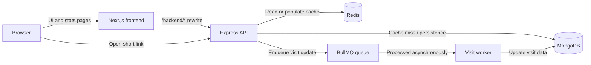

<div align="center">

# 🔗 URL Shortener

**Long URLs in. Short links out. Fast redirects, async analytics.**

A full-stack URL shortener — **Next.js** frontend, **Express** API, **MongoDB** persistence, **Redis** cache-first redirects, and **BullMQ** background visit tracking.

[](https://nodejs.org/)
[](https://expressjs.com/)
[](https://nextjs.org/)
[](https://www.typescriptlang.org/)
[](https://www.mongodb.com/)
[](https://redis.io/)
[](https://docs.bullmq.io/)
[](./LICENSE)

[🚀 Quick start](#-quick-start) · [🏗 Architecture](#️-architecture) · [📡 API](#-api-reference) · [🩺 Troubleshooting](#-troubleshooting) · [🗺 Roadmap](#️-roadmap)

</div>

> **TL;DR** — Start Mongo + Redis (`docker compose up -d`), run `npm install && npm run dev` in `backend/`, `npm run worker:dev` in a second terminal, then `npm install && npm run dev` in `frontend/`. Open [localhost:3000](http://localhost:3000).

<!--  -->

---

## 🚀 Why this project

URL shortening is a tiny product with genuinely interesting engineering behind it: safe input validation, collision-resistant identifiers, cache-first reads, and asynchronous analytics. This repository shows how those parts fit together — keeping the redirect path independent from slower visit-count writes, so redirects never block on a database update.

---

## ⚡ Quick start

### Requirements

| Requirement | Notes |
|-------------|-------|
| Node.js 20+ | npm is bundled |
| MongoDB 6+ | Local or hosted (Atlas) |
| Redis 6+ | Local or hosted |
| Docker *(optional)* | Simplest way to run Mongo + Redis locally |

### 1. Start infrastructure

```bash
docker compose up -d
```

Create `docker-compose.yml` at the repo root if you don't have one:

```yaml
services:
  mongo:
    image: mongo:8
    ports: ["27017:27017"]
    volumes: ["mongo-data:/data/db"]
  redis:
    image: redis:7-alpine
    ports: ["6379:6379"]
    volumes: ["redis-data:/data"]
volumes:
  mongo-data:
  redis-data:
```

### 2. Start the backend

```bash
cd backend
cp .env.example .env
npm install
npm run dev
```

API listens at `http://localhost:3001`.

### 3. Start the visit-counting worker

In a second terminal:

```bash
cd backend
npm run worker:dev
```

> Without the worker, redirects still work — but visit counts won't increment.

### 4. Start the frontend

```bash
cd frontend
cp .env.local.example .env.local
npm install
npm run dev
```

Open [http://localhost:3000](http://localhost:3000).

### 5. Smoke-test the API

```bash
# Create
curl -X POST http://localhost:3001/api/url_shortener \
  -H "Content-Type: application/json" \
  -d '{"longURL":"https://www.example.com/articles/a-long-page"}'

# Stats (replace <code>)
curl http://localhost:3001/api/<code>/stats

# Redirect (replace <code>)
curl -i http://localhost:3001/<code>
```

---

## 🏗 Architecture



The redirect resolves via Redis first, MongoDB on a miss. Visit counting is decoupled: the 302 returns immediately and the worker persists the increment. Unknown codes return `404` and may be negatively cached briefly.

---

## 📡 API reference

**Local API base:** `http://localhost:3001`  
**Frontend proxy base:** `http://localhost:3000/backend`

| Method | Endpoint | Description |
|--------|----------|-------------|
| `POST` | `/api/url_shortener` | Create a short link |
| `GET` | `/api/:code/stats` | Retrieve a link's statistics |
| `GET` | `/:code` | Redirect to the original URL |
| `GET` | `/health` | Liveness probe |

All errors share one shape: `{ "message": "..." }`.

**Create:** `POST /api/url_shortener` with `{ "longURL": "https://..." }` → `201` with `{ message, url }`.

**Stats:** `GET /api/:code/stats` → `200` with `{ message, url }` where `url` includes `totalVisits` and `lastVisitedAt`.

**Redirect:** `GET /:code` → `302` to the original URL, or `404` if unknown.

Visit totals are eventually consistent — they update asynchronously via the worker.

---

## 📁 Project structure

```
url-shortener-api/
├── backend/
│   ├── server.js          # API entry point
│   ├── worker.js          # Visit-counting worker (+ flush scheduler)
│   ├── src/
│   │   ├── app.js         # Express app setup
│   │   ├── config/        # MongoDB, Redis, BullMQ connections
│   │   ├── controllers/   # Request handling & response shaping
│   │   ├── middleware/    # Central error handling
│   │   ├── models/        # Mongoose URL model
│   │   ├── routes/        # API & redirect routes
│   │   ├── services/      # URL creation, lookup, cache, visit logic
│   │   └── utils/         # Validators & application errors
│   └── tests/             # Jest unit tests
├── frontend/
│   ├── next.config.ts     # Next.js rewrites (/backend/* → API)
│   └── src/
│       ├── app/           # Home, shorten, stats pages
│       ├── components/    # Forms, statistics, UI
│       └── lib/           # API client, validators, formatting
├── docs/
│   ├── ENGINEERING.md     # Deep-dive: cache, flush, validation, dirty set
│   └── FAQ.md             # FAQ and glossary
├── docker-compose.yml     # Mongo + Redis for local dev
└── PRD.md                 # V1 product specification
```

---

## 🧪 Scripts and testing

### Backend

| Command | Purpose |
|---------|---------|
| `npm start` | Production API |
| `npm run dev` | API with auto-restart |
| `npm run worker` | BullMQ visit worker |
| `npm run worker:dev` | Worker with auto-restart |
| `npm test` | Jest unit tests |

### Frontend

| Command | Purpose |
|---------|---------|
| `npm run dev` | Next.js dev server |
| `npm run build` | Production build |
| `npm start` | Serve production build |
| `npm run lint` | Lint |

Backend unit tests live in `backend/tests/unit/`. Run `npm test` from `backend/` to execute them. Deep-dive engineering notes (cache keys, flush algorithm, validation rules) are in `docs/ENGINEERING.md`.

---

## 🚢 Deployment and security

Before exposing publicly:

- Set `NEXT_PUBLIC_API_URL` to the public API origin and rebuild the frontend.
- Configure production CORS to allow only trusted frontend origins.
- Use HTTPS for all public traffic, and TLS for MongoDB / Redis where supported.
- Store credentials in your host's secret manager — never commit `.env`.
- Run the worker separately from the API and supervise both (pm2, systemd, or your platform's process manager).
- Enable Redis persistence (`appendonly yes`) if visit counts must survive restarts.

### Hardening checklist

- [ ] `helmet` — security headers
- [ ] `express-rate-limit` — protect `POST /api/url_shortener`
- [ ] `compression` — response gzip
- [ ] Graceful shutdown — close Mongo, Redis, BullMQ on `SIGTERM`
- [ ] SSRF guard — block private/link-local destinations
- [ ] `/health` endpoint
- [ ] BullMQ retry / backoff / DLQ for failed visit jobs

Short links can redirect users to arbitrary destinations. Syntax validation alone doesn't guarantee a destination is safe — plan for reporting / takedown flows if this service is public.

---

## 🩺 Troubleshooting

| Symptom | Likely cause | What to check |
|---------|-------------|---------------|
| MongoDB connection refused | Mongo stopped / bad `MONGO_URI` | Start Mongo; verify URI; whitelist IP in Atlas |
| Redis connection refused on `6379` | Redis stopped / wrong host or port | Check `REDIS_HOST`, `REDIS_PORT` |
| `EADDRINUSE :::3001` | Port already in use | Stop the other process or change `PORT` |
| Frontend can't reach the API | Rewrite target wrong | Verify `BACKEND_URL` and `/backend/*` rewrite |
| Short link 404s | Typo / unknown code / negative cache | Codes are case-sensitive; wait for negative-cache TTL |
| Visit total doesn't change | Worker not running | Start `npm run worker`; allow a moment for async updates |
| Deployed short link points at `localhost` | `NEXT_PUBLIC_API_URL` not set | Set it to the deployed API origin and rebuild |
| `401` / CORS errors after deploy | CORS not configured | Allow the exact frontend origin in the API's CORS config |

---

## 🗺️ Roadmap

- [ ] **P0** — Automated unit + integration tests and CI workflow
- [ ] **P0** — `/health` endpoint + graceful shutdown
- [ ] **P0** — Rate limiting on `POST /api/url_shortener`
- [ ] **P1** — OpenAPI spec served at `/docs`
- [ ] **P1** — Custom short codes / branded aliases
- [ ] **P2** — Link expiry and automatic deletion
- [ ] **P2** — Per-day and per-country analytics
- [ ] **P3** — Click-data export (CSV)

---

## 🤝 Contributing

Contributions welcome. Workflow:

1. Open or check an issue describing the change.
2. Branch: `feat/custom-alias`, `fix/redirect-cache`, `docs/env-examples`, …
3. Keep API changes inside the existing **Routes → Controllers → Services** layers.
4. Keep frontend and backend validation rules aligned.
5. Run lint / build / tests locally, and smoke-test the full create → redirect → stats flow.
6. Open a PR with a concise summary, test notes, and screenshots for UI changes.

**Commit convention:** Conventional Commits — `feat:`, `fix:`, `docs:`, `chore:`, `refactor:`, `test:`.

**Don't commit:** `.env`, credentials, `node_modules`, `.next`, `dist`.

---

## 🙏 Acknowledgements

- [NanoID](https://github.com/ai/nanoid) — short code generation
- [BullMQ](https://docs.bullmq.io/) — background jobs
- [shadcn/ui](https://ui.shadcn.com/) — component primitives
- [Lucide](https://lucide.dev/) — icons
- [Mermaid](https://mermaid.js.org/) — architecture diagrams

---

## 📄 License

Licensed under the **MIT License** — see [`LICENSE`](./LICENSE).
